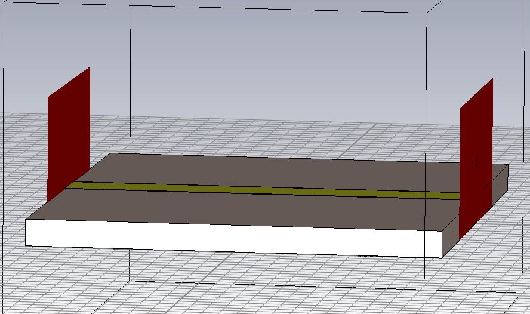
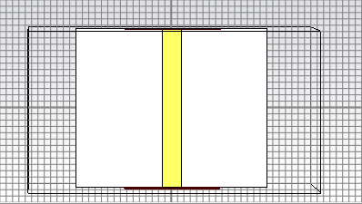
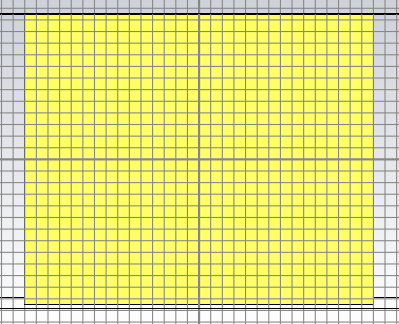
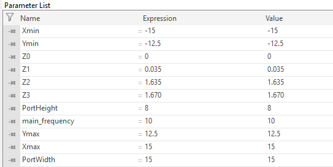
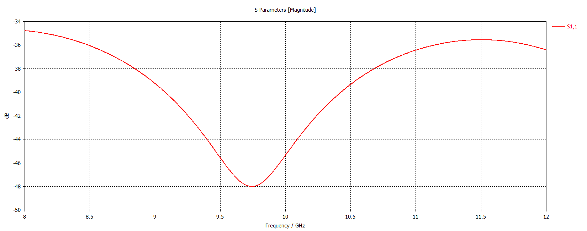
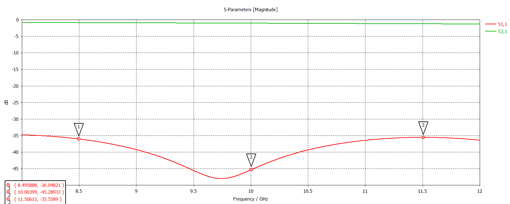
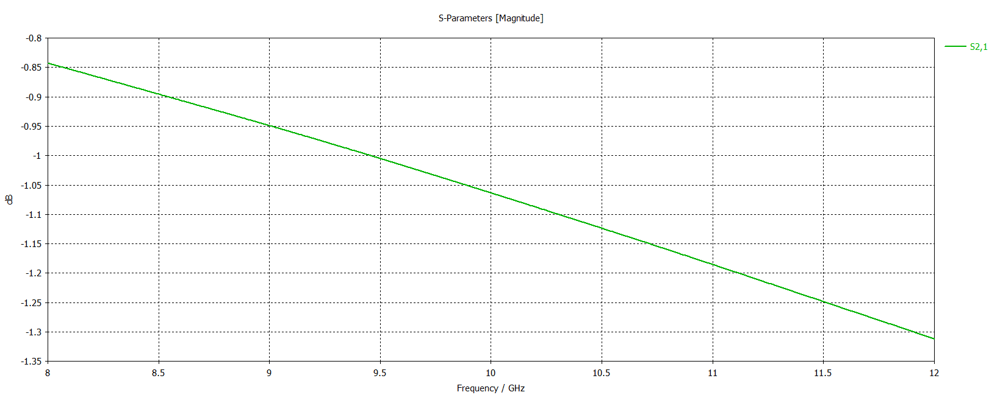
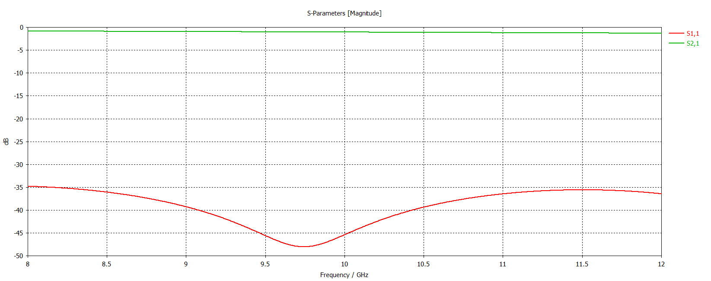
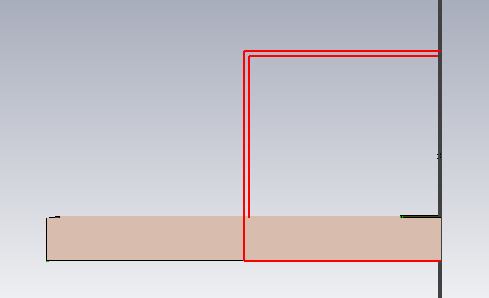

# X-Band Microstrip Transmission Line | CST Studio Suite

**Electromagnetic modeling and S-parameter analysis of a microstrip transmission line across the X-band (8–12 GHz).**

This repository documents the **unmodified reference line** used as the baseline for a planned defected ground structure (DGS) study. No ground-plane slots have been added in this version.

## Overview

A two-port microstrip transmission line was modeled and simulated in CST Studio Suite to examine input matching (S11) and forward transmission (S21) over 8–12 GHz. The model includes a signal trace, a dielectric substrate, a ground plane, and waveguide ports at the line ends.

The supplied model screenshots show a layered microstrip structure described as FR4-based in the original project context. The dielectric constant, loss tangent, trace width, and detailed solver settings **have not been independently verified from these screenshots**, so they are not listed as measured specifications here.

## 3D design



| Top view | Ground-plane view |
|---|---|
|  |  |

### Geometry parameters visible in CST

The following values are transcribed from the CST parameter-list screenshot. **CST length units are assumed to be millimeters; please verify in the project settings before citing absolute dimensions.**

| CST parameter | Value | Interpretation |
|:--|--:|:--|
| `Xmin`, `Xmax` | −15, +15 | X extent: 30 model units |
| `Ymin`, `Ymax` | −12.5, +12.5 | Y extent: 25 model units |
| `Z0` | 0 | Stack reference level |
| `Z1` | 0.035 | First stack boundary |
| `Z2` | 1.635 | Second stack boundary |
| `Z3` | 1.670 | Third stack boundary |
| `PortWidth` | 15 | Port width parameter |
| `PortHeight` | 8 | Port height parameter |
| `main_frequency` | 10 | Design frequency (GHz) |

The Z offsets are consistent with **0.035 / 1.600 / 0.035 model-unit** layer thicknesses; confirm the corresponding object assignments in CST. The screen does **not** show the signal trace width or dielectric properties, so these are intentionally omitted.



## Simulated S-parameters

Both plots cover **8–12 GHz**.

### Reflection coefficient — S11



From the marked S11 screenshot:

| Frequency (GHz) | S11 (dB) |
|--:|--:|
| 8.495888 | −36.04821 |
| 10.00399 | −45.28933 |
| 11.50613 | −35.55890 |

Around 9.7–9.8 GHz, the S11 curve reaches roughly **−48 dB** (visual estimate, not an exact marker reading). At about 10 GHz, S11 is approximately **−45.29 dB**, indicating very low reflection and good simulated input matching at that point.



### Forward transmission — S21



Across 8–12 GHz, S21 decreases smoothly from about **−0.85 dB** to **−1.31 dB**, based on visual readings from the plot. At **10 GHz, S21 is approximately −1.06 dB**. These are estimates from an image, not exported numerical data.

A pronounced transmission notch is not visible in this unmodified baseline model.

### Combined response



## Port configuration

The model contains a port at each end of the trace. A side view of the port region is included below; this image is **not a mesh-convergence plot**.



## Next study: Defected Ground Structures (DGS)

The planned extension is to etch different slot geometries into the **ground plane below the microstrip trace**, then compare their S11 and S21 responses. Slot dimensions will be swept to identify how geometry affects the frequency of maximum transmission attenuation. The current version does **not** contain those results.

## Files

```text
X-Band-Microstrip-Line-CST/
├── README.md
├── Images/
│   ├── 01_3D_Model.png
│   ├── 02_Top_View.png
│   ├── 03_Bottom_View.png
│   ├── 04_Parameter_List.png
│   ├── 05_S21.png
│   ├── 06_S11_S21_Combined.png
│   ├── 07_S11_Markers.png
│   ├── 08_Port_Side_View.png
│   └── 09_S11.png
├── docs/
│   └── Technical_Notes.md
├── CST_Project/
│   └── XBand_Microstrip.cst
└── Simulation_Results/
    └── EXPORT_NOTES.md
```

## Reproducibility and limitations

- This package includes the supplied **CST model file** (`CST_Project/XBand_Microstrip.cst`) and screenshots, but no raw S-parameter exports. The model has not been opened or re-simulated independently for this repository; CST Studio Suite is required to verify the project and reproduce the results.
- Mesh convergence has **not** been documented in the supplied images; no convergence claim is made.
- Precise material constants, trace dimensions, port reference impedances, solver and mesh parameters should be checked directly in the original CST project.
- All observations are **simulation results**, not physical measurements.

---

*Software: CST Studio Suite. Frequency range: X-band (8–12 GHz). Project stage: unmodified microstrip line baseline.*
